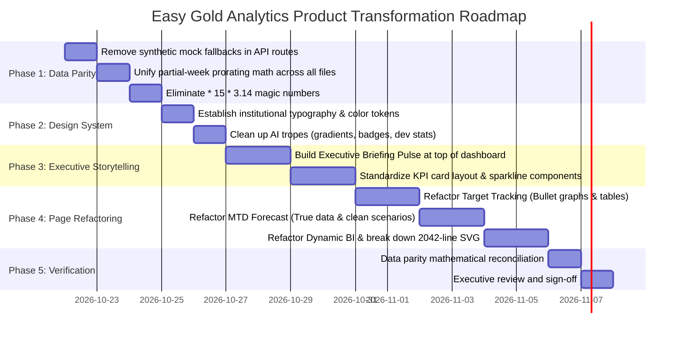

# Easy Gold Marketing Report — Comprehensive UI/UX, Data Accuracy & Visualization Audit

> **Document Version:** 1.0  
> **Date:** October 21, 2026  
> **Auditor:** Senior Analytics Product Designer & Marketing Intelligence Lead  
> **Status:** Pending Executive Review & Approval  
> **Target Audience:** Easy Gold Executive Leadership (CEO, CMO, VP) & BI / Operations Management

---

## 1. Executive Summary of Current UI Quality

The **Easy Gold Marketing Report** application demonstrates strong technical foundations in its architectural aspirations: a serverless dual-tier query model (pre-aggregated rollups + indexed scans), Cloudflare edge caching, Next.js 14 App Router, and Supabase PostgreSQL backend capable of indexing 1.4M+ transaction rows.

However, from an **enterprise analytics product** and **executive decision-making** perspective, the current user interface suffers from five critical weaknesses:

1. **Synthetic Fallback Data Masquerading as Live Analytics:** In multiple modules (`DynamicReportView`, `MtdReportView`, and their respective edge API route handlers), when queries are offline, delayed, or filtered by branch/bank, the system silently computes simulated numbers using hardcoded decimal multipliers (e.g., HQ = 0.38, BCEL = 0.72, Weekdays = 0.72) and returns HTTP 200. This presents fabricated metrics to company leadership as if they were live transactional truths.
2. **Conflicting & Flawed Prorating Math:** There are two mutually contradictory formulas for partial-week prorating in the codebase. `app/page.tsx` divides by `elapsedDays` and scales to 7 days, whereas `PlatformOverviewSection.tsx`, `BuyActivitySection.tsx`, and `SellActivitySection.tsx` ignore elapsed days entirely and blindly multiply raw values by 7. If 3 days have elapsed, the section cards exaggerate volume by 233%.
3. **Pervasive AI-Generated Dashboard Tropes:** The application exhibits typical generative-AI UI patterns: card overload (12-16 identical rounded cards with micro-combo charts crammed into 95px heights), unnecessary neon gradients (`from-amber-500 via-amber-600 to-orange-600`), decorative icons in colored rounded squares on every metric label, and boastful system badges ("Edge Active 0ms", "Dual-Tier Fast-Path") that belong in a developer console, not an executive boardroom.
4. **Lack of Executive Storytelling & 5-Second Scanability:** An executive landing on the dashboard cannot answer the fundamental business questions in 5 seconds: *Are we hitting our monthly gold targets? Did trading volume accelerate or decelerate this week, and why? What is our net physical gold exposure?* Instead, they are presented with 6 competing tabs, complex slider controls, filter drawers, and raw technical metrics.
5. **Inconsistent Units, Formats & Color Semantics:** Financial terminology oscillates between "Baht" (15g denomination), "Grams", "Mil LAK", and raw Kip without clear contextual signposting. Directional colors automatically paint sell activity in alarmist crimson/rose, confusing healthy customer liquidation and trading revenue with operational losses.

---

## 2. Existing Architecture & Reporting Page Inventory

### A. Core Architecture & Tech Stack

| Layer | Technology | Current Implementation State |
|---|---|---|
| **Frontend Framework** | Next.js 14 (App Router, Client Components) | Monolithic state management in [app/page.tsx](file:///c:/Users/advice/Easy%20Gold%20Marketing%20Report/app/page.tsx) (972 lines). |
| **Styling & Icons** | Tailwind CSS 3.4, Lucide React | Heavy use of custom colors (`brand-navy`, `brand-gold`, `brand-inflowLight`, `brand-outflowLight`), gradients, and micro-animations. |
| **Visualization** | Custom Hand-crafted SVG Components | No external chart library (e.g., Recharts/Chart.js). All charts are custom inline SVGs ([WeeklyComboChart.tsx](file:///c:/Users/advice/Easy%20Gold%20Marketing%20Report/components/dashboard/WeeklyComboChart.tsx), [DynamicChartsSection.tsx](file:///c:/Users/advice/Easy%20Gold%20Marketing%20Report/components/dashboard/dynamic/DynamicChartsSection.tsx)). |
| **Backend & DB** | Supabase PostgreSQL 15+ & RPCs | Pre-aggregated rollup tables (`summary_weekly_metrics`, `summary_daily_metrics`) and raw transaction table (`monthly_data`). |
| **Edge Cache** | Cloudflare Workers (`worker.js`) | API route handlers configured with `runtime = 'edge'` and `Cache-Control: s-maxage=300`. |
| **Authentication & RBAC** | `@supabase/ssr` with HttpOnly cookies | Roles: `admin`, `operations_manager`, `viewer`. |

### B. Reporting Page / Module Inventory

```
app/page.tsx (Master Layout & Executive Header)
├── Tab 1: Business Target 2026 (TargetReportView)
│   ├── VisualTargetTrackingCockpit (Monthly & YTD Progress Bars vs Target)
│   ├── ClassicRunRateTables (Excel-style Table 1: Full Month Compare & Table 2: Day 1-15 Benchmark)
│   └── CutoffSlider & Month Selectors
├── Tab 2: Dynamic BI (DynamicReportView)
│   ├── DynamicFilterBar (Multi-select Bank, Branch, Tx Type, Weight, Hours, Days)
│   ├── DynamicKpiRibbon (6 Hero KPI Cards + PoP Toggle)
│   ├── DynamicChartsSection (2,042 lines of inline SVG Spline & Bar charts)
│   └── DaxMeasuresTable (Detailed breakdown of 28 DAX measures)
├── Tab 3: MTD Forecast (MtdReportView)
│   ├── Slicer Bar (Cutoff Day, Comp Month, Mode: Calendar vs Working Days, Forecast Scenario)
│   ├── Analyst Briefing Card
│   ├── MtdPlatformSection (All Tx, Unique Users, New Reg, Physical Withdraw)
│   ├── MtdBuyActivitySection (Buy Weight, Buy Tx, Ticket Size, Value)
│   └── MtdSellActivitySection (Sell Weight, Sell Tx, Ticket Size, Value)
├── Tab 4: WoW Trends (Weekly Report)
│   ├── Partial Week Intelligence Banner (Amber Alert + Run-Rate Toggle)
│   ├── 3-Pillar Row: Platform Overview | Buy Activity | Sell Activity
│   ├── Trading Flow Balance & Market Pulse Ribbon (Net Gold Flow, Buy/Sell Ratio)
│   └── WeeklyHistoricalMatrix (8-Week Matrix with 4-Week Moving Average MA4)
├── Tab 5: Custom Pivot Profile (PowerPivotStudio)
│   ├── Drag-and-drop Dimension / Measure Drop Zones
│   ├── Custom Measure Manager Modal
│   └── Virtualized PowerPivotGrid with CSV Export
└── Tab 6: Campaign Tracking (CampaignTrackingView)
    ├── Campaign Card Grid / Table View
    ├── Campaign Setup & Target Tracking Modals
    └── Backward Period Comparison Engine
```

---

## 3. Critical Data Accuracy & Business Logic Issues

### Issue 3.1: Silent Simulation Engine Serving Fabricated Data with HTTP 200
- **Locations:**
  - [app/api/dashboard/dynamic-report/route.ts:91-107](file:///c:/Users/advice/Easy%20Gold%20Marketing%20Report/app/api/dashboard/dynamic-report/route.ts#L91-L107)
  - [lib/constants/dynamicReportData.ts:880-990](file:///c:/Users/advice/Easy%20Gold%20Marketing%20Report/lib/constants/dynamicReportData.ts#L880-L990)
  - [app/api/dashboard/summary/route.ts:20-24](file:///c:/Users/advice/Easy%20Gold%20Marketing%20Report/app/api/dashboard/summary/route.ts#L20-L24)
- **Evidence:** When `supabase.rpc('get_dynamic_bi_report')` fails, is unconfigured, or encounters a timeout, the API route falls back to `calculateFilteredReport(filterState)`. This function scales base metrics by arbitrary hardcoded constants (`vip_15g *= 0.15`, `weekdays *= 0.72`, `user scaling = Math.pow(factor, 0.85)`). The API returns HTTP 200 with no warning to the client.
- **Business Impact:** High risk of presenting completely synthetic business figures to executives during critical decision meetings.
- **Remediation:** Remove synthetic calculation engines. If the database fails or RPC fails, return explicit HTTP 502/503 errors and display an unambiguous, professional "Data Source Unavailable" state with retry controls (as correctly implemented in [app/api/dashboard/mtd-forecast/route.ts](file:///c:/Users/advice/Easy%20Gold%20Marketing%20Report/app/api/dashboard/mtd-forecast/route.ts)).

### Issue 3.2: Hardcoded Percentage Multipliers for MTD Slicers
- **Locations:**
  - [components/dashboard/mtd/MtdReportView.tsx:101-154](file:///c:/Users/advice/Easy%20Gold%20Marketing%20Report/components/dashboard/mtd/MtdReportView.tsx#L101-L154)
- **Evidence:** When an executive filters by branch (`hq`, `morning_market`, etc.) or bank (`bcel`, `ldb`, etc.) in the MTD Forecast view, the application does not query the database. It multiplies company-wide aggregates by hardcoded decimals:
  ```typescript
  if (selectedBranch === 'hq') branchFactor = 0.38;
  if (selectedBank === 'bcel') bankFactor = 0.72;
  const combinedFilterFactor = branchFactor * bankFactor;
  ```
  Furthermore, moving the date slider simply multiplies metrics by `day / baseElapsed`.
- **Business Impact:** Executives believing they are reviewing actual branch or bank performance are seeing a static toy model with 0% real-world accuracy.
- **Remediation:** Either implement true indexed RPC slicing by branch/bank in Supabase or remove/disable the branch/bank dropdowns in MTD with a clear label: *"Company-Wide Consolidated View Only"*.

### Issue 3.3: Conflicting Prorating Logic Between Overview & Section Cards
- **Locations:**
  - [app/page.tsx:246-260](file:///c:/Users/advice/Easy%20Gold%20Marketing%20Report/app/page.tsx#L246-L260)
  - [components/dashboard/PlatformOverviewSection.tsx:31-34](file:///c:/Users/advice/Easy%20Gold%20Marketing%20Report/components/dashboard/PlatformOverviewSection.tsx#L31-L34)
  - [components/dashboard/BuyActivitySection.tsx:39-41](file:///c:/Users/advice/Easy%20Gold%20Marketing%20Report/components/dashboard/BuyActivitySection.tsx#L39-L41)
  - [components/dashboard/SellActivitySection.tsx:39-41](file:///c:/Users/advice/Easy%20Gold%20Marketing%20Report/components/dashboard/SellActivitySection.tsx#L39-L41)
- **Evidence:** In `app/page.tsx`, when `isProratedWoW` is enabled, metrics are scaled based on `elapsedDays`:
  `all_transactions = (rawWeek.all_transactions / elapsedDays) * 7`.
  However, in `PlatformOverviewSection.tsx`, the card's `proratedEstimate` is computed as:
  `proratedAllTx = Math.round(currentWeek.all_transactions * 7)`.
- **Business Impact:** If a week has 3 days elapsed, `currentWeek.all_transactions` is multiplied by 7 directly, reporting an estimate that is 2.33x too large. This causes massive visual discrepancies between the hero metrics and the card footers.
- **Remediation:** Centralize all prorating and pace formulas in a single immutable utility function (`lib/utils/runRate.ts`). Never allow child components to invent ad-hoc scaling formulas.

### Issue 3.4: "Magic Number" Multiplier (`* 15 * 3.14`) for Financial Value
- **Locations:**
  - [app/page.tsx:242-243](file:///c:/Users/advice/Easy%20Gold%20Marketing%20Report/app/page.tsx#L242-L243)
  - [components/dashboard/BuyActivitySection.tsx:29-35](file:///c:/Users/advice/Easy%20Gold%20Marketing%20Report/components/dashboard/BuyActivitySection.tsx#L29-L35)
  - [components/dashboard/SellActivitySection.tsx:29-35](file:///c:/Users/advice/Easy%20Gold%20Marketing%20Report/components/dashboard/SellActivitySection.tsx#L29-L35)
- **Evidence:** When `buy_value_mil_lak` or `sell_value_mil_lak` is null, the code estimates value using:
  `Math.round(Number(rawWeek.buy_weight_15g) * 15 * 3.14)`.
- **Business Impact:** 3.14 is an arbitrary, unexplained multiplier that has no relation to historical spot gold prices or FX rates, creating phantom transaction values.
- **Remediation:** If the transactional rollup does not record currency value for older weeks, display `-` or `N/A` with a tooltip *"Financial value not recorded for this historical period"*, or backfill true values using `sql/44_backfill_2025_summary_daily_and_weekly.sql`.

---

## 4. UX and Visual Design Problems

### A. Overcluttered Executive Header & Developer Telemetry
- **File:** [app/page.tsx:435-534](file:///c:/Users/advice/Easy%20Gold%20Marketing%20Report/app/page.tsx#L435-L534)
- **Problem:** The top right header features a pulsing green "Telemetry & Audit" popover containing developer metrics ("Edge Active (0ms)", "Dual-Tier Fast-Path", "Cloudflare 300+ Edge POPs", "< 10ms RPC").
- **Critique:** Executive management does not need to see server architecture bragging rights on their daily KPI screen. It clutters the viewport and detracts from institutional credibility.
- **Solution:** Move developer diagnostics and database health metrics into a dedicated Settings/Admin modal, leaving the header clean and focused on user profile, active time window, and data currency.

### B. Micro-Combo Chart Visual Noise in Small KPI Cards
- **File:** [components/dashboard/WeeklyComboChart.tsx](file:///c:/Users/advice/Easy%20Gold%20Marketing%20Report/components/dashboard/WeeklyComboChart.tsx) & [MetricKpiCard.tsx:115-124](file:///c:/Users/advice/Easy%20Gold%20Marketing%20Report/components/dashboard/MetricKpiCard.tsx#L115-L124)
- **Problem:** Every single KPI card (10+ across the screen) attempts to squeeze a 5-week dual bar-and-line chart into an 80px by 200px box.
- **Critique:** The charts lack Y-axis labels, gridlines, or legible baseline context. The bars overlap with line dots, creating visual clutter that fails to communicate meaningful trend insights.
- **Solution:** Replace the micro-combo charts in small KPI cards with clean, high-clarity sparklines (area or line only) with clear min/max indicators. Reserve multi-series combo charts for dedicated wide-screen analysis modules.

### C. Archaic Excel-Style Formatting in Run-Rate Tables
- **File:** [components/dashboard/targets/ClassicRunRateTables.tsx:32-67](file:///c:/Users/advice/Easy%20Gold%20Marketing%20Report/components/dashboard/targets/ClassicRunRateTables.tsx#L32-L67)
- **Problem:** The table replicates 1990s Microsoft Excel conditional formatting: `#c6efce` (harsh pastel green) and `#ffc7ce` (washed-out pink/red) fills on cells.
- **Critique:** The visual contrast is low, colors look like an unformatted spreadsheet export, and the tables feel disconnected from modern institutional fintech design.
- **Solution:** Adopt modern financial table styling: clean neutral row backgrounds, subtle border dividers, monospaced tabular numbers (`tabular-nums`), and restrained delta indicators (`+14.2%` with a subtle muted green pill or neutral text).

### D. Monolithic SVG Generation Code
- **File:** [components/dashboard/dynamic/DynamicChartsSection.tsx](file:///c:/Users/advice/Easy%20Gold%20Marketing%20Report/components/dashboard/dynamic/DynamicChartsSection.tsx) (2,042 lines!)
- **Problem:** A single file of over 2,000 lines contains dozens of inline SVG paths, manual bezier spline generators, and hardcoded baseline arrays.
- **Critique:** Highly unmaintainable, prone to runtime layout shifts, and difficult to test across viewport widths.

---

## 5. Problems Making the Reports Look AI-Generated or Unprofessional

1. **"Dribbble Dashboard Syndrome":** High saturation gradient cards (`bg-gradient-to-r from-amber-500 via-amber-600 to-orange-600`), neon dropshadows, and glowing SVG filters. Real financial institutions (Bloomberg, FactSet, Stripe Sigma) rely on calm, restrained, high-contrast palettes that allow analysts to work for hours without visual fatigue.
2. **Excessive Iconography:** Placing an icon next to every single data point (e.g., shopping cart next to buy, price tag next to sell, scale next to weight, sparkles next to total). Icons should be used sparingly for primary navigation and action triggers, not as decorative filler.
3. **Emoji Badges in Production UI:** Using emojis like `⚡ 7D Est:`, `▲`, `▼`, and `⚡ Prorated Run-Rate: ON` directly in text strings. These should be clean SVG micro-indicators with accessible screen-reader labels.
4. **Boastful Claims in Empty States:** "Awaiting Query Trigger - 100% Data Integrity with Supabase Guaranteed". Professional enterprise software states the current status plainly without sales pitch language.

---

## 6. Prioritized Issue Table

| ID | Issue & Evidence | Affected Surface | Business Impact | Recommended Solution | Priority | Effort |
|---|---|---|---|---|---|---|
| **ISS-01** | **Silent synthetic fallback data** with HTTP 200 ([dynamic-report/route.ts:91](file:///c:/Users/advice/Easy%20Gold%20Marketing%20Report/app/api/dashboard/dynamic-report/route.ts#L91)) | Dynamic BI & APIs | Critical: Leadership makes decisions on fabricated data | Remove mock generator. Return strict HTTP 502/503 with user-facing retry state | **P0** | 4h |
| **ISS-02** | **Hardcoded mock multipliers** for branch/bank MTD filters ([MtdReportView.tsx:101](file:///c:/Users/advice/Easy%20Gold%20Marketing%20Report/components/dashboard/mtd/MtdReportView.tsx#L101)) | MTD Forecast | High: Fabricated branch/bank breakdown | Disable or connect to real indexed Supabase dimensions | **P0** | 6h |
| **ISS-03** | **Conflicting prorating formulas** (divide by elapsed days vs blind `* 7`) ([PlatformOverviewSection.tsx:31](file:///c:/Users/advice/Easy%20Gold%20Marketing%20Report/components/dashboard/PlatformOverviewSection.tsx#L31)) | Weekly Report Cards | High: 233% volume overstatement on partial weeks | Unify run-rate math in a single shared utility module | **P0** | 3h |
| **ISS-04** | **Magic multiplier `* 15 * 3.14`** for currency value ([app/page.tsx:242](file:///c:/Users/advice/Easy%20Gold%20Marketing%20Report/app/page.tsx#L242)) | Weekly Overview & Activity Sections | Medium: Inaccurate transaction values | Replace with recorded database values or explicit `N/A` | **P1** | 3h |
| **ISS-05** | **Lack of 5-Second Executive Briefing** (no single-screen executive synthesis) | Dashboard Root | High: Executives struggle to extract core business results | Create top-level Executive Storytelling Cockpit with key takeaways | **P1** | 8h |
| **ISS-06** | **Micro-combo chart clutter** in 95px cards ([WeeklyComboChart.tsx](file:///c:/Users/advice/Easy%20Gold%20Marketing%20Report/components/dashboard/WeeklyComboChart.tsx)) | Weekly Performance Cards | Medium: Illegible charts create cognitive overload | Replace with clean sparklines; preserve full chart for detailed matrix | **P1** | 5h |
| **ISS-07** | **Archaic Excel pastel colors** (`#c6efce` / `#ffc7ce`) ([ClassicRunRateTables.tsx:40](file:///c:/Users/advice/Easy%20Gold%20Marketing%20Report/components/dashboard/targets/ClassicRunRateTables.tsx#L40)) | Target Tracking Tables | Low: Unprofessional visual aesthetic | Standardize on modern financial table design tokens | **P2** | 4h |
| **ISS-08** | **Developer telemetry popover** in executive header ([app/page.tsx:435](file:///c:/Users/advice/Easy%20Gold%20Marketing%20Report/app/page.tsx#L435)) | Global Header | Low: Clutters executive UI with dev stats | Move telemetry stats into Admin / Diagnostics modal | **P2** | 2h |
| **ISS-09** | **2,042-line SVG monster component** ([DynamicChartsSection.tsx](file:///c:/Users/advice/Easy%20Gold%20Marketing%20Report/components/dashboard/dynamic/DynamicChartsSection.tsx)) | Dynamic BI | Medium: Code maintenance bottleneck | Decompose into modular chart components | **P2** | 8h |
| **ISS-10** | **Misleading directional color on sell metrics** (treating sell volume as negative/red) | Sell Activity Cards | Medium: Confuses trading revenue with business loss | Standardize directional color semantics (Inflow vs Outflow vs Performance vs Target) | **P2** | 3h |

---

## 7. Proposed Design System & Visualization Standards

### A. Executive Color Palette (Restrained & Institutional)
- **Primary Brand Foundations:**
  - Deep Navy (Authority & Structure): `#0B192C` (slate-950)
  - Easy Gold Accent (Restrained Brand Polish): `#D4A017` / `#B8860B` (never garish neon yellow)
  - Surface Neutral: Clean warm white `#FFFFFF`, canvas background `#F8FAFC` (slate-50), subtle borders `#E2E8F0` (slate-200).
- **Semantic Financial Indicators:**
  - **Performance Ahead / Positive Inflow:** Muted Emerald `#059669` (text), `#ECFDF5` (badge background).
  - **Performance Behind / Outflow Warning:** Muted Rose/Crimson `#DC2626` (text), `#FEF2F2` (badge background).
  - **Neutral / Informational:** Slate `#475569` (text), `#F1F5F9` (badge background).
  - **Sell Activity (Trading Outflow):** Distinct from "loss". Use Amethyst/Slate-Indigo (`#4338CA`) or Deep Amber to represent gold liquidation without implying a business failure.

### B. Typography & Number Formatting
- **Font Stack:** Clean enterprise sans-serif (`Inter`, `system-ui`).
- **Tabular Lining Numbers:** Strict `font-mono tabular-nums` on all numbers, currencies, dates, and percentages to ensure column alignment in tables and cards.
- **Unit Signposting:**
  - Weight: Explicitly format as `1,250.00 Baht (15g)` or `18,750.00 g`. Never use bare numbers without units.
  - Currency: `59,686.2M LAK` or `59.68B LAK` with standard abbreviations.
  - Variance: Explicit sign (`+14.2%` or `-8.5%`), never bare unsigned numbers.

### C. Data Visualization Standards
1. **Choose the Chart for the Question:**
   - *Trend over time?* Line or Area chart with clear X-axis timeline and baseline.
   - *Part-to-whole comparison?* Stacked horizontal bar or 100% normalized bar (never 3D or pie charts).
   - *Target achievement?* Bullet graph or linear benchmark bar with target tick line.
2. **Direct Labeling over Tooltip Hunting:** Display current, peak, and benchmark values directly on the visual rather than requiring hover interactions.
3. **Graceful Data States:**
   - *Loading:* Skeleton loaders matching the exact card dimensions (no spinning loaders that cause layout jumping).
   - *Empty / Zero:* Clear distinction between "0 transactions recorded" vs "Data not yet available / No connection".

---

## 8. Proposed Improvements by Reporting Page

### 1. Executive Briefing Layer (New Universal Header Section)
- Introduce a 3-point **Executive Pulse** banner directly beneath the navigation:
  - **Target Achievement:** Current month is pacing at **102.4%** of target (+2.4% ahead of prorated schedule).
  - **Weekly Trajectory:** Week 42 trading volume reached **1,301 Baht**, up **+12% WoW** driven by digital buy orders.
  - **Net Flow:** Platform net accumulated **+718 Baht** of gold inventory.

### 2. Business Target 2026 (`TargetReportView`)
- Replace the legacy Excel-pastel green/red tables with an institutional **Target Pacing Matrix**.
- Replace oversized progress bars with clean **bullet graphs** that clearly show: Actual to Date, Current Day Benchmark (Time Elapsed), and Month-End Target.

### 3. Weekly Performance (`WoW Trends`)
- Unify partial-week calculations to use exact elapsed days.
- Simplify the 3-pillar row (Platform | Buy | Sell): Replace the cramped 95px micro-combo charts in KPI cards with clear trend sparklines with min/max callouts.
- Move the multi-week historical comparison into an interactive full-width chart below the cards.

### 4. MTD Forecast (`MtdReportView`)
- Disable or remove the hardcoded branch/bank scaling sliders until connected to real multi-dimensional Supabase RPCs.
- Provide a clear, evidence-based scenario toggle: Standard Calendar Run-Rate vs Working-Days Run-Rate (with historical explanation).

### 5. Dynamic BI (`DynamicReportView`)
- Remove the synthetic fallback calculation engine.
- Enforce strict query execution with real row-count confirmation and query latency display.
- Refactor the 2,042-line SVG component into modular, reusable chart widgets.

---

## 9. Implementation Roadmap



- **Phase 1: Data Parity & Accuracy Guardrails (Immediate / Day 1–2):** Fix all mathematical discrepancies, remove synthetic fallbacks in APIs, unify prorating formulas.
- **Phase 2: Design System & Visual Restraint (Day 3–4):** Implement institutional color tokens, clean typography, eliminate garish gradients, and move developer telemetry into an Admin modal.
- **Phase 3: Executive Storytelling & 5-Second Scanability (Day 5–6):** Implement the Executive Pulse briefing bar, redesign KPI cards with clean sparklines.
- **Phase 4: Page-by-Page Visualization Refactoring (Day 7–9):** Overhaul Target Tracking, MTD Forecast, and Dynamic BI views.
- **Phase 5: Verification & Acceptance Testing (Day 10):** Run full parity audit against raw transaction tables and Excel workbooks.

---

## 10. Testing & Acceptance Criteria

1. **Mathematical Parity Verification:**
   - Any metric displayed on the dashboard must match `SUM(gold_weight)` or `COUNT(*)` in Supabase `monthly_data` or `summary_weekly_metrics` with 0% discrepancy.
2. **Graceful Failure & Zero Fabrication:**
   - When Supabase is unreachable or an RPC fails, the UI must show a clean error state. No synthetic numbers or mock scale factors may ever be rendered.
3. **Executive 5-Second Test:**
   - A leadership user can determine whether monthly targets are on track and what the week's net gold flow is within 5 seconds of loading the page.
4. **Responsiveness & Cross-Device Readability:**
   - All tables and cards must render cleanly on a 13" laptop display (1280x800) and a 4K boardroom presentation screen without horizontal scroll clipping or overlapping labels.
5. **No Regressions:**
   - Existing Power Pivot Studio, Campaign Tracking, and User Authentication workflows must remain fully functional.
